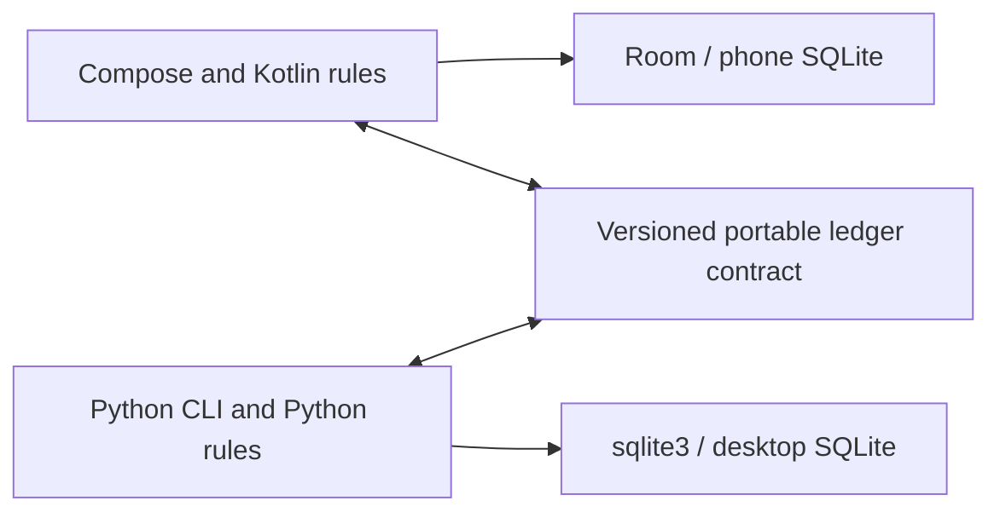

# Application architecture options

There is no existing application code to reuse. All options use a local SQLite
database on each installation and a versioned portable file between devices.
They require no server, login, background network task, or hosted database.

## A. Native interfaces and a Kotlin Multiplatform core

Adopted on 2026-10-31. Options B and C below are historical alternatives.

Use Jetpack Compose for Android, a Kotlin/JVM command application for desktop,
and Kotlin Multiplatform (KMP) libraries for shared financial rules, storage, and
transfer. SQLDelight supplies typed SQL and schema migrations. Android uses its
Android driver; desktop uses its SQLite JDBC driver. A future iOS application
can use SwiftUI and SQLDelight's native SQLite driver.

This revises the original JVM-only proposal following the 2026-10-26 requirement
for near-term iOS extensibility. KMP is the recommended preparation; the first
release still contains only the Android application and desktop CLI.

Android minimum is Android 16, API level 36 (`minSdk = 36`). Publish a signed
release APK for direct installation. Select compatible dependency versions
and compile/target SDKs during implementation; minimum SDK alone does not
define those versions. Preserve the application ID and signing identity for
updates so installing a newer APK does not require removing the existing app.
Protect the signing keystore separately from user-ledger backups.

A conventional Gradle multi-project structure could be:

```text
apps/android/                  Android app, Compose screens and ViewModels
apps/cli/                      JVM application and terminal formatting
shared/finance/                KMP amounts, dates, commands and budget summaries
shared/storage/                KMP SQLDelight schema, queries and migrations
shared/transfer/               KMP file format, validation and transfer state
docs/architecture/             Product and architecture decisions
```

Put portable code in each shared module's `commonMain` source set and shared
tests in `commonTest`. Configure Android and JVM targets for the first release.
Keep Android APIs in the Android application and desktop APIs in the CLI.
Choose shared dependencies with Kotlin/Native iOS support; JVM compatibility
alone does not demonstrate iOS compatibility.

Do not use `java.time`, `java.io`, `java.sql`, Android `Context`, or Compose
ViewModels in common code. Use multiplatform date/serialization facilities
where needed. Inject clocks, identifiers, SQLite drivers, and external file
access through the real platform boundaries. Keep localized money formatting
in presentation; the core exposes exact minor-unit amounts and currency.

The expense flow is:

```text
Compose form or CLI command
  -> shared expense command validates amount, date, method, editing state
  -> shared storage transaction writes expense and advances local edit counter
  -> shared summary query calculates totals
  -> Compose state or CLI renderer presents the result
```

Use ViewModels and observable state on Android. Run database and file work away
from the UI thread. Let committed database state drive charts and lists so a
failed save cannot leave the UI displaying an uncommitted expense.

Place budget arithmetic, month membership, money parsing, and chart aggregation
in shared finance code. SQL queries select and group relevant records; checked
integer arithmetic must still protect totals from overflow. UI code formats
results and never implements another budget formula.

Inject concrete storage adapters, a clock, and UUID generation at application
entry points. Define a small project-owned interface only at a real external
boundary where it helps isolate the dependency. Keep SQLDelight-generated
types inside storage, serialization types inside transfer, and UI models inside
their applications. Constructor wiring is sufficient initially.

Keep module dependencies acyclic: finance owns financial types and the narrow
persistence contract its commands require; storage depends on finance and
implements that contract. Transfer depends on finance and storage for import
transactions. Applications compose those modules. Finance must not import
storage or UI classes. The persistence contract is an actual third-party
boundary, not a generic repository framework.

The storage module owns schema changes for every client. Test migrations
against each supported SQLite driver and choose SQL features supported by the
oldest supported runtime. Opening a database created by a newer incompatible
schema must fail safely with an upgrade message rather than recreating tables.

The first CLI release targets Linux x86_64, confirmed on 2026-10-31. Bundle a
suitable JVM runtime, for example through `jpackage`, so end users need not
install Java separately. Verify packaging and SQLite native-library loading on
a Linux x86_64 machine without a separately installed JVM.

Advantages:

- Native Android UI, accessibility, lifecycle, and file-picker integration.
- One implementation of financial rules, transfer guards, and schema changes.
- SQL remains inspectable, and the desktop ledger is an ordinary SQLite file.

Costs:

- KMP source sets and compatible dependencies add build constraints immediately.
- Gradle, Android tooling, and JVM packaging are part of the project.
- Android SQLite and JDBC SQLite may differ in supported SQL and behavior.
- Shared code needs discipline to avoid platform-only APIs.

**Recommendation:** the strongest fit for native Android now, native iOS soon,
and a CLI that shares the financial implementation with both.

### What adding iOS would require

| Area | Reuse | iOS-specific work |
| --- | --- | --- |
| Financial operations | Money/date validation, budgets, income, expense lifecycle, chart totals | Swift-facing calls and state presentation |
| Local persistence | SQLDelight schema, queries, migration logic and storage adapters | Native SQLite driver, sandbox database path, lifecycle integration |
| Portable files | Format, validation, checkpoint guards and conflict decisions | Document picker, share sheet and durable private staging |
| Interface | Financial outputs and behavior fixtures | SwiftUI screens, charts, accessibility and navigation |
| Packaging | Shared source and contracts | Xcode project, signing, Apple platform tests and distribution |

Add iOS simulator/device targets to the shared modules and expose a Kotlin/Native
framework for the SwiftUI application. Introduce an iOS app entry point that
provides its SQLite driver, private paths, clock/UUID adapter where needed, and
file access. Keep Swift interop small: financial commands and summary values,
not generated SQLDelight types or Android ViewModels. Adapt asynchronous
operations and observation to Swift's lifecycle and cancellation explicitly.

Use the same ledger format across phone platforms. Moving an existing Android
ledger to iOS uses import/export with the same validation and conflict policy;
it does not need a new server or financial schema solely because iOS was added.
Driver-specific SQL behavior and migrations still require verification.

KMP shares the core, not the Android interface. SwiftUI is new UI work. If shared
mobile UI is a stronger priority than native platform interfaces, option C
becomes more attractive; choose that deliberately rather than promising UI
reuse from Android-specific Compose code.

A small shared-core compile check on macOS with the appropriate Xcode toolchain
can verify dependency portability before iOS development. Until that check,
native SQLite migration tests, and Swift integration run, iOS support remains
a design intention rather than a verified capability. No iOS application,
signing setup, or empty iOS modules are needed for the first release.

## B. Native Android with an independent Python CLI

Use Compose, Kotlin financial code, and Room on Android. Use Python's standard
`sqlite3`, `argparse`, and `decimal` modules for the desktop CLI. Exchange the
same versioned financial documents; each application imports them into its
own schema.



Organize Android by its standard app conventions. Keep the CLI under a Python
package with separate command, finance, storage, and transfer modules. Use a
repository-level directory of contract fixtures consumed by both test suites.

Room owns Android persistence and migrations. The Python CLI owns its database
migrations. Do not promise binary interchangeability between these databases:
their physical schemas and framework metadata may differ. The portable format
is the shared contract.

Advantages:

- Familiar Android persistence tooling and an approachable desktop CLI.
- The CLI can start with standard-library dependencies.
- Each interface can follow its own language's conventions.

Costs:

- Money rules, date rules, transfer validation, and migrations exist twice.
- Shared fixture tests detect drift but do not remove duplicated code.
- Both applications need coordinated file-format compatibility policies.

**Choose this** when Python is a strong team preference and the team accepts
the continuing cost of maintaining parity. It deliberately trades the project's
no-duplication preference for independent platform implementations; option A
fits that preference better.

For future iOS, this option also needs an iOS financial implementation or a
separate move to a KMP core. The portable file contract remains reusable, but
the current Kotlin/JVM and Python code cannot run unchanged as an iOS core.

## C. Flutter application and a shared Dart core

Use Flutter for Android, a Dart console application on desktop, and shared pure
Dart packages for financial operations and transfer. Use Drift's generated
queries and migrations with its platform-specific SQLite executors. Keep the
shared packages independent of Flutter widgets and plugins.

```text
apps/mobile/                   Flutter Android application
apps/cli/                      Dart console application
packages/finance/              Pure Dart financial operations
packages/storage/              Drift schema, migrations and query adapters
packages/transfer/             Portable files and import/export workflow
```

Use explicit 64-bit amount bounds and checked arithmetic on the selected native
targets. Do not assume the same integer guarantees if a browser build is added
later. Wrap file-picker and SQLite plugins at the application boundary.

Advantages:

- Financial rules, persistence queries, and transfer behavior can be shared.
- Shared mobile UI and financial code can target Android and future iOS.
- A desktop CLI can be distributed as a compiled Dart executable.

Costs:

- Flutter adds a UI runtime and plugin lifecycle to both mobile applications.
- Accessibility, lifecycle integration, and platform file access still need work.
- Native SQLite libraries and file access need packaging for each target.

**Choose this** when sharing the Android/iOS UI is a priority or the team already
knows Flutter. The near-term iOS requirement makes it a concrete alternative to
KMP with separate native interfaces. Target Android first and add iOS packaging
and platform integrations later.

## Ownership rules across all options

- Financial code owns budgeting semantics and exact arithmetic.
- Storage owns transactions, constraints, queries, and database migrations.
- Transfer owns file compatibility, lineage checks, and atomic import.
- Platform entry points own permissions, file access, and dependency wiring.
- Presentation owns interaction, localization, and accessible rendering.

Reports should be projections of stored financial records. Do not persist a
second editable copy of remaining budget or chart totals. Introduce caching
only after measurement demonstrates a need, with explicit invalidation rules.
