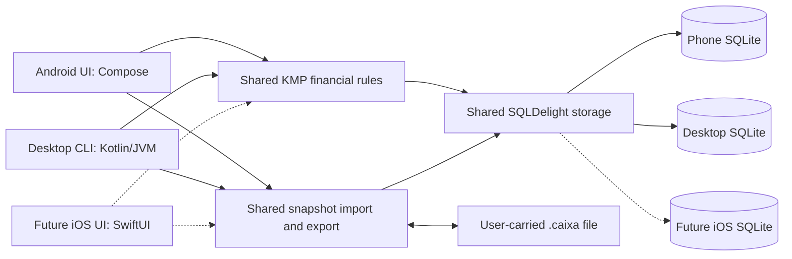

# Caixa architecture

Status: first-release product, platform, architecture, and backup decisions adopted.
The first implementation path is present; host build verification still needs
the selected JDK, Gradle, and Android SDK toolchain.

Caixa is an Android application for entering expenses, defining a budget from
income sources, and seeing spending against that budget. It works without a
network connection. A desktop CLI provides the same financial operations and
stores its working ledger in SQLite. Users carry their ledger between devices
through a file they control.

## Read these documents

1. [Product, experience, and financial rules](01-product-and-domain.md)
2. [Application architecture options](02-application-options.md)
3. [Portable files and bidirectional transfer](03-transfer-and-sync.md)
4. [Delivery plan and open decisions](04-delivery-and-decisions.md)

## Requirements

- Fast manual expense entry, including debit or credit; default to credit.
- A budget defined by recurring planned income registered once, with optional monthly overrides.
- Planned expenses that reserve budget until recorded or cancelled.
- Charts and exact amounts for budget, spending, reservations, and available budget.
- Complete local operation on Android and desktop.
- Desktop SQLite storage readable by the CLI and ordinary SQLite tools.
- Phone-to-computer and computer-to-phone transfer without a required server.
- Identical financial results on both interfaces.
- A portable core for near-term iOS support, with no iOS app in the first release.
- Android 16 (API 36) minimum, distributed as a signed APK.
- English interface with locale-aware dates and amounts.

The CLI should support entering, listing, editing, and deleting expenses;
maintaining recurring income and monthly overrides; displaying budget summaries; and transferring
the ledger. Its charts can use terminal bars while retaining the same totals.

## Adopted starting design

Use native Android with Jetpack Compose, a Kotlin/JVM CLI, and shared Kotlin
Multiplatform modules for financial rules, SQLDelight storage, and portable
file processing. A later SwiftUI iOS application can consume that core with
native SQLite and file-access adapters. The first release ships Android and CLI.
Both applications keep their own SQLite database. Transport a versioned ledger
snapshot through Android's system file picker and ordinary desktop files.

Start with an explicit handoff workflow: export, continue editing on the other
device, and export back. Guard against replacing changes made independently on
both devices. Automatic merging is deferred. When histories conflict, warn the
user, preserve both copies, and require an explicit choice of the correct
version. Export makes the sender read-only until the ledger returns, with an
explicit Resume editing here escape hatch. Conflicts select one complete ledger
and preserve recoverable copies of both versions.

The database nodes represent separate installations. Each application connects
the shared storage code to its own database through the appropriate driver.

## Options at a glance

| Design | Financial rules | Storage | Main benefit | Main cost |
| --- | --- | --- | --- | --- |
| A. Compose + Kotlin CLI, future SwiftUI | Shared KMP | SQLDelight with platform drivers | Shared core with native Android/iOS interfaces | KMP tooling, separate mobile UIs, JVM desktop packaging |
| B. Compose + Python CLI | Kotlin and Python | Room on Android, Python `sqlite3` on desktop | Familiar platform tools and a small CLI | Duplicated rules and migrations require parity checks |
| C. Flutter + Dart CLI | Shared Dart | Drift with platform SQLite executors | Shared rules and convenient future UI expansion | Flutter runtime and less native Android integration |

Option A was adopted on 2026-10-31. Options B and C are retained as considered
alternatives. All three support offline SQLite and file transfer.

Near-term iOS support was requested on 2026-10-26. The recommended shared modules
now use KMP rather than the original JVM-only libraries. Android Compose screens
do not automatically become iOS screens; option C offers shared UI if that is
preferred. See the application-options document for the iOS adoption path.

## Adopted financial defaults

- One ledger and one currency, with two decimal places, for the first release.
- Calendar-month budgets, with no automatic carryover.
- Recurring income and monthly overrides define planned budget, not confirmed bank deposits.
- Recorded expenses consume budget immediately, including credit purchases.
- Planned expenses reserve budget without increasing recorded spending.
- Remaining budget can be negative; overspending remains visible.
- Credit identifies a payment method; card statements and debt are a later
  product decision.

Planned income and immediate credit consumption were confirmed on 2026-10-21.
One currency per ledger, calendar-month periods, and no automatic carryover
were adopted on 2026-10-31. Confirm the currency during initial setup; BRL in
the preview is sample content rather than a forced application currency.

## Confirmed decisions — 2026-10-21

1. Automatic merging is unnecessary for now. Conflicting edits require a warning
   and an explicit user decision; no version wins silently.
2. Credit purchases consume budget when recorded.
3. Income sources represent planned income.
4. Portable files require no password for now and use the plaintext format.

## Adopted planned expenses — 2026-10-26

Planned expenses are part of the first release. They reserve budget separately
from recorded spending. Recording an expense releases its reservation and
charges the actual amount in one transaction. Both interfaces and portable
files preserve the lifecycle, with shared finance tests covering the core cases.

## Recurring income and expense dates — 2026-10-30

Register monthly income once; it continues automatically from its starting
month until changed or stopped. Effective-month changes preserve past budgets;
one-month overrides support exceptions. The income screen no longer requires
copying or entering income each month. New expenses default to the local date
when entered, including when the selected report month differs from today.

## Platform and product defaults — 2026-10-31

The Compose/KMP/SQLDelight/Kotlin CLI stack, read-only handoff, whole-ledger
conflict selection, calendar-month budgets without carryover, and a single
setup-confirmed currency are adopted. Android requires version 16 (API 36) or
later. Distribute a signed APK. Launch language is English, with locale-aware
formatting. The CLI targets Linux x86_64 with a bundled JVM.

Version the portable format independently from SQLite and reject unsupported
versions safely. The detailed local-backup, retention, recovery, and Android
system-backup policies in the transfer document were adopted on 2026-10-31.
Linux x86_64 was confirmed as the initial CLI target on 2026-10-31. There are no
remaining product or platform decisions blocking first-release implementation.
Resolve routine dependency versions, build wiring, and packaging details during
implementation.
