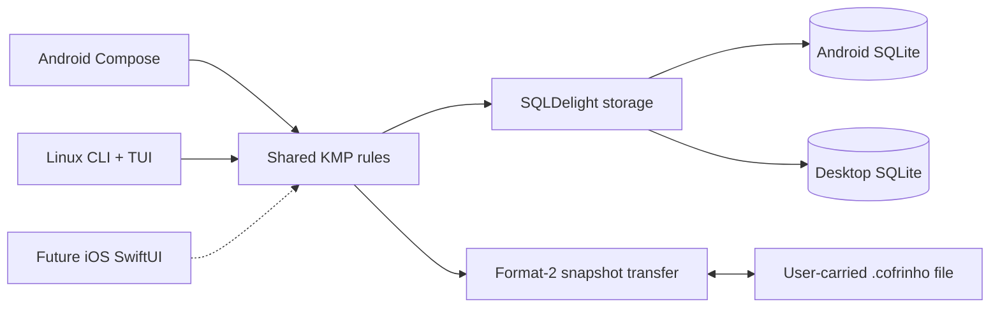

# Cofrinho architecture

Status: first-release architecture and product decisions adopted. The current
release uses recurring income, recurring expenses, and dated variable spending;
planned expenses are not part of the model.

Cofrinho is an offline-first Android application with a Linux x86_64 CLI. Both
interfaces use the same Kotlin Multiplatform financial rules, SQLDelight-backed
SQLite storage, and versioned `.cofrinho` snapshot files. Android is distributed
as a signed APK. The CLI is packaged with a bundled JDK.

## Read these documents

1. [Product and domain rules](01-product-and-domain.md)
2. [Application architecture options](02-application-options.md)
3. [Portable files and bidirectional transfer](03-transfer-and-sync.md)
4. [Delivery plan and decisions](04-delivery-and-decisions.md)

## Product requirements

- Record dated variable expenses quickly, with credit or debit; credit is the default.
- Register income sources once; recurring schedules define each month's planned budget.
- Register recurring expenses once; each active month reduces the available budget.
- Change recurring amounts from an effective month, override one month, clear an
  override, or stop a schedule. Zero-valued overrides skip a month.
- Display income, recurring spending, variable spending, used, available, daily
  variable totals, and credit/debit variable totals.
- Work without a network connection on Android and Linux.
- Transfer whole ledgers through user-controlled files with explicit conflict choices.
- Keep the financial core platform-neutral for a future iOS client; no iOS UI ships in v1.

The selected monthly calculation is:

```text
income    = resolved recurring income
recurring = resolved recurring expenses
variable  = dated expenses purchased in the month
used      = recurring + variable
available = income - used
```

## Adopted architecture

Use native Android Compose, a Kotlin/JVM CLI, Kotlin Multiplatform shared
finance/storage/transfer modules, and SQLDelight with platform drivers.



Android and the CLI keep separate local databases. Export places the sender in
read-only handoff mode until the returned file is imported or editing is
explicitly resumed. Divergent histories are not merged automatically: the user
chooses the complete ledger to keep, while recoverable copies are preserved.

## Compatibility boundary

The recurring-expense cutover is intentionally breaking. Schema generation 3,
portable format 2, and new-format backups are required. Legacy, unversioned,
malformed, or format-1 databases/files are rejected without modification; no
automatic migration or planned-expense conversion exists. Users who need old
records must retain the old binary and its database, then create a fresh ledger
for this release.

## Platform defaults

- Android minimum: API 36 (Android 16), direct signed APK distribution.
- CLI target: Linux x86_64 with a bundled JDK 17 runtime.
- Interface language: English with locale-aware date and amount formatting.
- Transfer files: plaintext JSON, no password in v1.
- Budget period: calendar month with no carryover.
- Currency: one setup-confirmed currency per ledger; exact signed 64-bit minor units.

Routine dependency versions, packaging wiring, signing setup, and backup
retention details are documented in the delivery and transfer documents.
